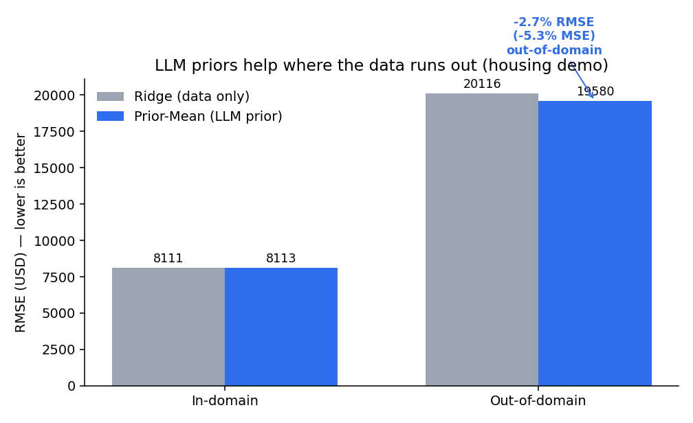

# expert-priors

[](https://github.com/Solvelangseth/expert-priors/actions/workflows/ci.yml)
[](https://www.python.org/)
[](LICENSE)

**LLM-elicited expert priors for regularized statistical models — better out-of-domain prediction with scalable domain knowledge.**

Point `expert-priors` at a dataset and a target. An LLM elicits coefficient
priors (and can write the feature descriptions for you), and you get
scikit-learn-style prior-informed models that hold up better when the test data
drifts away from the training domain.



*Housing demo with a built-in domain shift (trained on new homes, tested on old
ones). The LLM prior leaves in-domain error unchanged but cuts out-of-domain
error — domain knowledge fills in exactly where the training data runs out.
Reproduce it in [`examples/quickstart.ipynb`](examples/quickstart.ipynb).*

> Distilled into a clean, installable library from the master's thesis
> *“LLM-Elicited Priors for Regularized Statistical Models.”* The full frozen
> reproducibility pipeline (6 datasets × 12 LLM cells, locked CV + bootstrap)
> lives in a companion thesis repo (available on request). The model families
> here are numerically matched to that thesis code.

## Install

```bash
pip install -e ".[all]"        # all providers + plotting
# or pick what you need: ".[anthropic]", ".[openai]", ".[google]", ".[plot]"
```

## See it work (no API key)

```bash
pip install -e ".[plot]"
jupyter notebook examples/quickstart.ipynb   # runs off cached priors
```

The notebook walks raw data → cached LLM priors → a prior-informed model →
an ID/OOD benchmark showing the prior's out-of-domain lift.

## Quickstart

```python
import expert_priors as ep

# 1. Elicit priors. auto_context=True lets the LLM draft the feature
#    descriptions instead of you hand-writing them. Or pass prompt=... for
#    a fully custom prompt, or context=FeatureContext(...) for your own.
priors = ep.elicit_priors(
    X, y,
    task="regression",            # or "classification"
    model="claude-opus-4-8",      # latest Claude by default
    n_samples=50,
    auto_context=True,
    cache="priors/mydata.json",   # reruns/demos need no API key
)

# 2. Fit a prior-informed model — sklearn-compatible (fit/predict/get_params)
model = ep.PriorMeanRidge(priors, alpha="cv").fit(X_train, y_train)
preds = model.predict(X_test)

# 3. Or benchmark baseline vs every prior family on ID + OOD splits
report = ep.compare(X, y, priors, ood_mask=mask)
report.summary()   # tidy DataFrame
report.plot()      # OOD-lift figure
```

Classification works the same way — pass `task="classification"` and use the
`*Logistic` estimators (`ep.PriorMeanLogistic`, …); `compare()` then reports
AUC / F1 / LogLoss / Brier.

## How it works

```
raw table ─▶ generate_feature_context ─▶ elicit_priors ─▶ PriorBundle
              (LLM writes descriptions)   (parallel, cached)    │
                              ┌────────────────────────────────┴──────────────┐
                  PriorMean / Correlated / Independent × Ridge / Logistic    compare()
                       (sklearn estimators, raw-space priors)              ID/OOD + lift
```

Priors are elicited in **raw feature units** and standardized internally, so the
estimators fit on raw `X` and expose raw-space `coef_` like any sklearn model.

## Prior families

| Family | Penalty |
|---|---|
| `PriorMean{Ridge,Logistic}` | L2 toward the LLM prior mean μ |
| `Correlated{Ridge,Logistic}` | full precision `P = Σ⁻¹` from the LLM sample covariance |
| `Independent{Ridge,Logistic}` | diagonal precision `P_jj = λ / (var_j + ε)` |

Baselines for "OOD lift" comparisons: **Ridge** (regression) and **L2 Logistic**
(classification). All families share the same `½·λ·(β−μ)ᵀP(β−μ)` parameterization,
so the selected `λ` is comparable across them.

## Providers

Defaults to the latest Claude (`claude-opus-4-8`). Also supports OpenAI and
Google models — the provider is inferred from the model id, and keys are read
from the environment / a local `.env` (`ANTHROPIC_API_KEY`, `OPENAI_API_KEY`,
`GOOGLE_API_KEY`).

## What's included

- `PriorBundle` + `FeatureContext` data containers
- Six prior-informed sklearn estimators, numerically matched to the thesis code
- Elicitation with a multi-provider call layer, parallel sampling, and disk caching
- Auto feature-context generation (`auto_context=True` / `generate_feature_context`)
- `compare()` benchmark with ID/OOD metrics, lift-vs-baseline, and plotting
- A no-API-key example notebook with cached demo priors
- 40 tests (no network required)

## Ideas / not yet

- Published to PyPI (currently install from source)
- OpenAI and Google provider paths verified against the live APIs (only Anthropic is)
- Reasoning-mode elicitation (the thesis sweep used it; the library ships the non-reasoning path)
- A fuller CLI (`elicit` / `compare` subcommands)

## License

MIT
