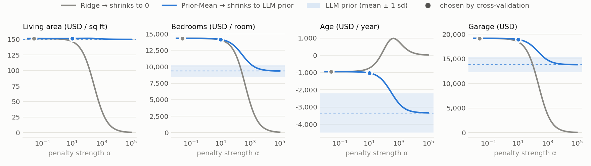

# expert-priors

[](https://github.com/Solvelangseth/expert-priors/actions/workflows/ci.yml)
[](https://www.python.org/)
[](LICENSE)

**Use an LLM's domain knowledge as a prior for regularized regression and classification.**

Ordinary regularization shrinks every coefficient toward zero. `expert-priors`
asks an LLM what the coefficients should look like, turns its answers into a
prior, and shrinks toward *that* instead. Cross-validation decides how much to
trust the prior, so when the data already speaks clearly, the model follows the data.



## Install

```bash
pip install "expert-priors[anthropic] @ git+https://github.com/Solvelangseth/expert-priors"
# other providers: [openai], [google], or [all]
```

## Usage

```python
import expert_priors as ep

# 1. Ask the LLM for 50 coefficient draws (cached, so reruns are free)
priors = ep.elicit_priors(X, y, task="regression", auto_context=True,
                          cache="priors/mydata.json")

# 2. Fit like any scikit-learn model
model = ep.PriorMeanRidge(priors).fit(X_train, y_train)
model.predict(X_test)

# 3. Compare against a plain Ridge baseline, in-domain and out-of-domain
ep.compare(X, y, priors, ood_mask=mask).summary()
```

For binary classification, pass `task="classification"` and use the `*Logistic`
estimators.

## Prior families

The LLM is sampled repeatedly, and each family uses those draws differently:

| Estimator | Shrinks toward | Uses |
|---|---|---|
| `PriorMeanRidge` / `PriorMeanLogistic` | prior mean | mean of the draws |
| `IndependentPriorRidge` / `IndependentPriorLogistic` | prior mean | + per-coefficient spread |
| `CorrelatedPriorRidge` / `CorrelatedPriorLogistic` | prior mean | + full covariance between coefficients |

All are scikit-learn estimators: they take raw `X`, standardize internally,
expose raw-unit `coef_`, and work with `clone`, pipelines and grid search.

## Features

- **Any provider.** Claude (default), OpenAI and Gemini; the provider is inferred
  from the model name and keys are read from the environment or a `.env` file.
- **Auto context.** `auto_context=True` lets the LLM draft the feature
  descriptions from column names and a few sample rows. Review them, or pass your
  own `FeatureContext` or a fully custom `prompt=`.
- **Raw-unit priors.** The LLM answers in the units of your data; scaling is
  handled for you.
- **Caching.** Elicited priors are saved as JSON, so experiments are reproducible
  without further API calls.

## Try it without an API key

[`examples/quickstart.ipynb`](examples/quickstart.ipynb) runs end to end on a
small synthetic housing dataset with cached priors.

## Background

The methods come from the master's thesis *"LLM-Elicited Priors for Regularized
Statistical Models"* (NMBU, 2026), where prior-informed models were evaluated
under distribution shift on several real-world datasets. The estimators here
reproduce the thesis implementation exactly.

## License

MIT
